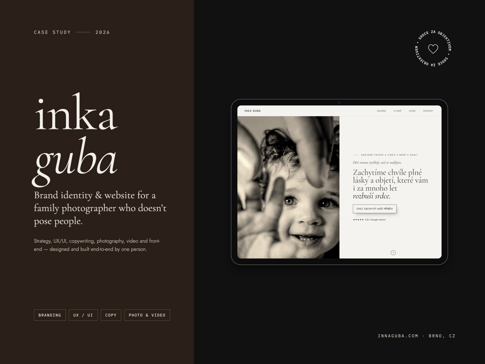

# innaguba.com

Website for **Inka Guba**, a family photographer and filmmaker in Brno, Czech Republic.
Research-led redesign: from a portfolio people admired to a website that parents act on.

**Live:** [innaguba.com](https://innaguba.com)



## The project

The old site looked lovely but brought almost no inquiries. Before designing anything I asked parents why:

- **Research (May 2026):** 3 in-depth interviews, a survey, competitive analysis, an affinity map and one working persona.
- **Key insight:** the barrier wasn't price, it was fear. *"What if the kids won't cooperate?"*
- **Prototype & testing:** a mobile booking flow, tested with 2 participants (think-aloud).
- **Key decision:** the calendar passed usability testing, but parents wanted to talk first. It became a short inquiry form instead.
- **Design & build (Sep–Oct 2026):** every homepage section answers a real worry from the research. Designed on real content and real phones, each round quieter than the last.

## Design system

- **Type:** Cormorant Garamond for emotion, Jost for everything practical. Three type sizes, one spacing scale.
- **Italic** only on words that carry feeling.
- **Rhythm:** dark and light sections alternate; one primary action per screen.
- **Colour:** warm paper, ink and walnut, taken from the photographs.

## Performance

A post-launch audit focused on parents browsing on phones, often on mobile data:

| | Before | After |
|---|---|---|
| Lighthouse performance (mobile) | 43 | 82 |
| Lighthouse performance (desktop) | 90 | 100 |
| Accessibility / SEO | | 98 / 100 |
| Homepage weight on a phone | 13 MB | 2.3 MB |

720p hero video for phones, right-sized WebP images, self-hosted fonts, videos that load on scroll.

## Tech

Plain HTML, CSS and vanilla JavaScript. No framework, no build step.
Hosted on GitHub Pages with a custom domain.

```
index.html, o-mne.html, cenik.html, kontakt.html   main pages
portfolio.html, galerie-*.html                     galleries (family, portraits, film)
css/style.css, css/home-theme.css                  styles
js/script.js                                       interactions, scroll effects
images/, videos/                                   optimised media
```

Run locally:

```bash
python3 -m http.server 8000
# open http://localhost:8000
```

## My role

UX research, UX/UI design, copywriting (Czech), photography and video, front-end.
I made the design decisions; the build was AI-assisted (Claude Code).

---

© 2026 Inna Macháč Guba. Photographs and videos are not licensed for reuse.
